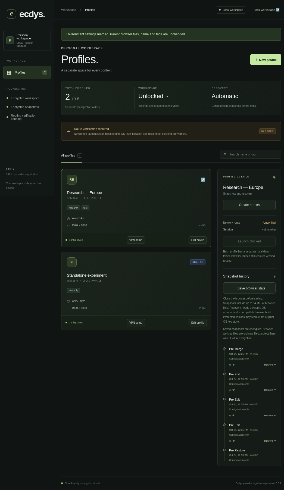
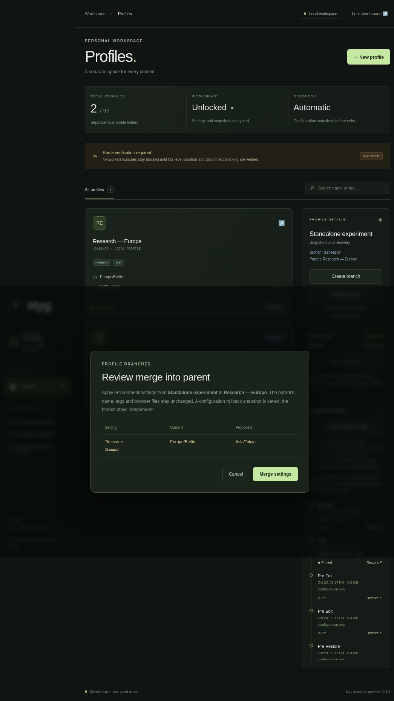
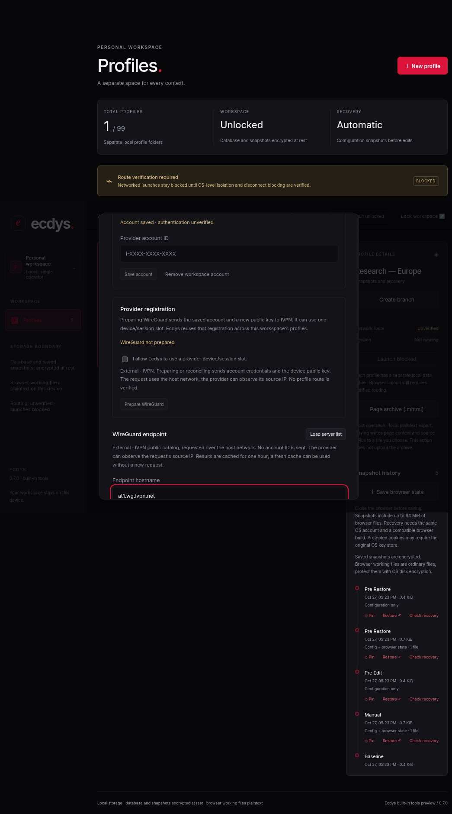
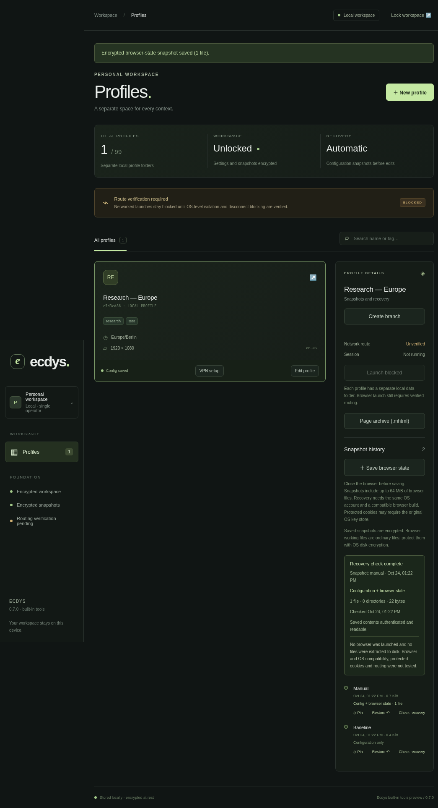

# Ecdys

Kloakbrowser

Desktop session and profile management. This is the Ecdys 0.7.0 built-in tools preview, not the full v1.0 blueprint.

Previously named Styg. Ecdys uses the existing `styg` application data folder so current encrypted workspaces open in place. Encryption formats, recovery markers and internal `styg` protocol/test identifiers stay compatible; no data migration is required. Earlier progress notes and plans retain the name used at the time.

See the [checked implementation plan](docs/PLAN-AUDIT.md) for delivered increments, partial blueprint requirements and blocked/planned work. Completed increment checkboxes do not mean the full v1 feature is available.

## What works

- Electron, Solid and TypeScript with a sandboxed renderer and validated IPC.
- Create, unlock and lock a local encrypted workspace. Argon2id runs in a worker; SQLCipher-compatible SQLite encrypts the database.
- Create/edit up to 99 profiles with separate local browser folders; search by name or tag.
- Automatic baseline/pre-edit configuration snapshots, plus manual encrypted backups of closed browser-directory data. Content-aware restore with rollback and interrupted-restore recovery.
- Configuration diffs before restore, revision-checked confirmations, and independent branches with copied files/history and a pinned fork point.
- Environment-setting merges with parent rollback, promotion to standalone, and recoverable branch discard.
- Random AES-256-GCM snapshot keys wrapped by a master-derived key, authenticated snapshot/profile identity, gzip level 9, pinning and retention of 20 unpinned snapshots.
- Internal managed Chromium lifecycle with private DevTools pipes, exclusive profile ownership, automatic closed-state snapshots and crash cleanup; exercised by local fixture tests.
- A backend/UI block on unverified networked launches and a Linux routing laboratory.
- Recoverable Mullvad/IVPN settings, encrypted workspace account storage, public WireGuard relay catalogs and saved rotation policies with explicit unverified-route diagnostics.
- Explicit Mullvad/IVPN account checks and WireGuard registration, encrypted retained keys/tokens, restart recovery, controlled removal and a non-secret tunnel preparation preview. Provider protocols are fixture-tested; live account acceptance remains unverified.
- Recheck-only requests cannot create registrations. Failed/canceled rechecks or removals clear preparation approval while retaining recovery material; reopened dialogs track pending operations and require fresh slot consent after removal.
- Searchable desktop Settings with a navigation rail, current-state panel, six accent colours, local appearance/density/motion preferences, optional status messages, device-preference reset, security controls and keyboard shortcuts. Unconnected services display their actual availability.
- **Recovery Rehearsal:** authenticate and decode a saved configuration/browser archive without changing current files. Reports identify coverage, counts and check time; Lock can interrupt the check.
- **Page archive:** native Chromium MHTML capture with a 4 MiB limit, SHA-256 digest and explicit native Save dialog. The engine is tested against a local Chromium fixture; normal app capture remains unavailable while browser launches are blocked. No extension is required. MHTML differs from SingleFile's HTML format.

**Normal browser launches remain disabled until a verified route supervisor and browser distribution are available.** OS tunnel activation, interactive provider CAPTCHA/2FA, fingerprint injection, billing and team services remain pending. VPN rotation policies are saved settings; automatic rotation is pending. Timezone, screen size and language are saved settings, not browser overrides. Real Chromium recovery tests restore persistent cookies, localStorage and IndexedDB on Linux with the same build/account and a test basic password store. OS-protected/cross-device cookies, tab history and sessionStorage recovery remain unverified.

## Run

Use Node 22.18+ (Node 24 recommended), pnpm 11.25+, and a desktop session. Linux needs Electron's standard libraries and a working Chromium sandbox.

```sh
pnpm install
pnpm electron:install
pnpm dev
```

Electron 45 requires an explicit binary install. If your managed environment requires its inherited proxy, use `NODE_USE_ENV_PROXY=1 pnpm electron:install`, keeping TLS verification enabled.

```sh
pnpm build
pnpm start
```

The workspace lives in Electron's `app.getPath('userData')/workspace`. Back up the whole workspace while Ecdys is closed: `workspace.json` holds non-secret KDF settings, `workspace.db` holds encrypted records/archives, and `profiles/` contains ordinary browser working files. Never delete them to resolve an unlock error. Schemas v1–v4 migrate automatically to v5; older apps require a matching pre-migration backup to roll back.

Passphrases require at least 12 characters and cannot be recovered. Default Argon2id cost: 256 MiB, 2 iterations. Alternatives: 64 MiB, 1 GiB or 4 GiB. Memory availability is checked before derivation. Ecdys locks after 15 minutes without a workspace operation, then reloads the renderer.

## Verify

```sh
pnpm typecheck
pnpm test
pnpm build
pnpm test:ui
pnpm test:desktop
```

The optional maximum-size round trip and branch rebinding check runs with `STYG_LARGE_STATE_TEST=1 pnpm test tests/state-large.test.ts`.

The backend real-browser recovery test and browser preview expect Linux Chromium. Tests default to `/usr/bin/chromium`; override with `STYG_TEST_CHROMIUM`. The desktop test runs the actual application with a temporary workspace. It uses headless Ozone and disables the sandbox only for the constrained test executor. Normal launch commands never disable the sandbox.

Native database builds worked under both Node and Electron here. If another platform reports an ABI mismatch, run `pnpm native:electron` for Electron or `pnpm native:node` before Node tests.

## Routing

```sh
pnpm routing:preflight
# On a suitable Linux host, after reading docs/ROUTING.md:
sudo node scripts/routing-proof.mjs --run
```

Exit 2 means prerequisites are missing, not that isolation passed. The lab uses simulated tunnel interfaces and checks IPv4/IPv6 HTTP, UDP and DNS, usable fallback controls and repeated disconnect blocking. Its privileged run remains unvalidated here; real loopback tests validate the probes only. It is not a provider VPN or full browser validation. A lab pass never enables launches.

See [functional acceptance](docs/FUNCTIONALITY.md), [Settings](docs/SETTINGS.md), [built-in tools](docs/TOOLS.md), [provider registration and recovery](docs/PROVISIONING.md), [VPN setup and provider corrections](docs/VPN.md), [managed sessions and recovery limits](docs/SESSIONS.md), [branches and previews](docs/BRANCHES.md), [snapshot format and recovery](docs/SNAPSHOTS.md), [routing details](docs/ROUTING.md), [delivery status](docs/STATUS.md) and the [recovery implementation plan](docs/superpowers/plans/2026-10-24-recovery-rehearsal.md).

## Security boundaries

This development foundation is not validated for high-risk investigations. The OS/local account can inspect application memory. Memory clearing is best effort. Directories are not VM boundaries. The database uses SQLite3MultipleCiphers in SQLCipher v4 compatibility mode, not a separately audited SQLCipher distribution. Independent audit and cross-platform tests remain required.

## Workspace screenshot








