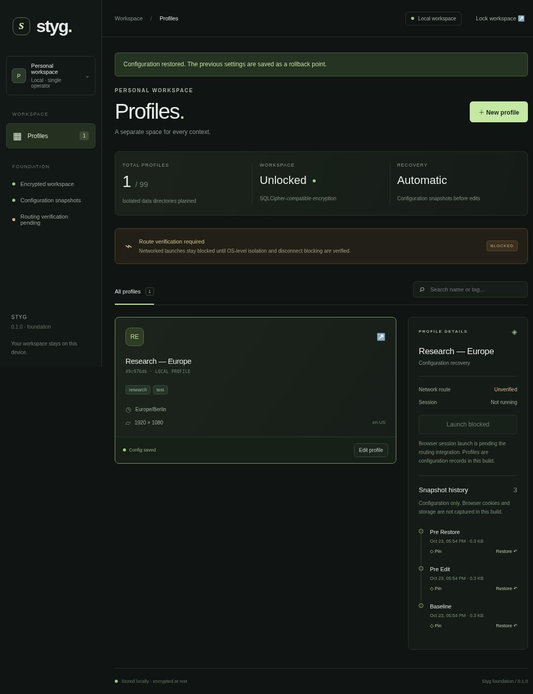

# Styg

Desktop session and profile management. This is the first working foundation, not the full v1.0 blueprint.

## What works

- Electron, Solid and TypeScript with a sandboxed renderer and validated IPC.
- Create, unlock and lock a local encrypted workspace. Argon2id runs in a worker; SQLCipher-compatible SQLite encrypts the database.
- Create/edit up to 99 configuration profiles; search by name or tag.
- Automatic baseline/pre-edit configuration snapshots. Restore with a pre-restore rollback point.
- Random AES-256-GCM snapshot keys wrapped by a master-derived key, authenticated snapshot/profile identity, gzip level 9, pinning and retention of 20 unpinned snapshots.
- A backend/UI block on unverified networked launches and a Linux routing laboratory.

**Browser session launch, browser-state capture, VPN integration, fingerprint injection, billing and team services are not implemented yet.** Timezone, screen size and language are saved settings, not browser overrides. Configuration snapshots do not capture cookies/localStorage.

## Run

Use Node 22.18+ (Node 24 recommended), pnpm 11.25+, and a desktop session. Linux needs Electron's standard libraries and a working Chromium sandbox.

```sh
pnpm install
pnpm electron:install
pnpm dev
```

Electron 45 requires an explicit binary install. If your managed environment requires its inherited proxy, use `NODE_USE_ENV_PROXY=1 pnpm electron:install`, keeping TLS verification enabled.

```sh
pnpm build
pnpm start
```

The workspace lives in Electron's `app.getPath('userData')/workspace`. Back up `workspace.json` (non-secret KDF salt/settings) and `workspace.db` (encrypted records) together while Styg is closed. Never delete them to resolve an unlock error.

Passphrases require at least 12 characters and cannot be recovered. Default Argon2id cost: 256 MiB, 2 iterations. Alternatives: 64 MiB, 1 GiB or 4 GiB. Memory availability is checked before derivation. Styg locks after 15 minutes without a workspace operation, then reloads the renderer.

## Verify

```sh
pnpm typecheck
pnpm test
pnpm build
pnpm test:ui
pnpm test:desktop
```

The browser test defaults to `/usr/bin/chromium`; override with `STYG_TEST_CHROMIUM`. The desktop test runs the actual application with a temporary workspace. It uses headless Ozone and disables the sandbox only for the constrained test executor. Normal launch commands never disable the sandbox.

Native database builds worked under both Node and Electron here. If another platform reports an ABI mismatch, run `pnpm native:electron` for Electron or `pnpm native:node` before Node tests.

## Routing

```sh
pnpm routing:preflight
# On a suitable Linux host, after reading docs/ROUTING.md:
sudo node scripts/routing-proof.mjs --run
```

Exit 2 means prerequisites are missing, not that isolation passed. The lab uses simulated tunnel interfaces to check local IPv4 route separation and firewall blocking. It is not a provider VPN or full browser validation. A lab pass never enables launches.

See [routing details](docs/ROUTING.md), [delivery status](docs/STATUS.md) and the [implementation plan](docs/superpowers/plans/2026-10-23-styg-foundation.md).

## Security boundaries

This development foundation is not validated for high-risk investigations. The OS/local account can inspect application memory. Memory clearing is best effort. Directories are not VM boundaries. The database uses SQLite3MultipleCiphers in SQLCipher v4 compatibility mode, not a separately audited SQLCipher distribution. Independent audit and cross-platform tests remain required.

## Workspace screenshot


