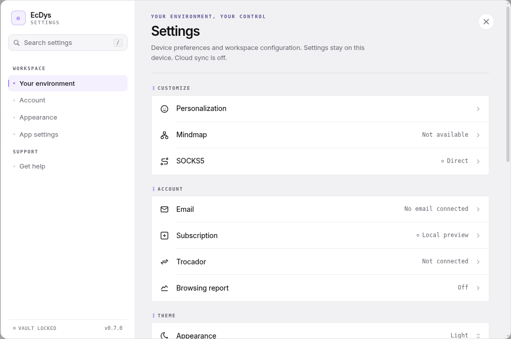
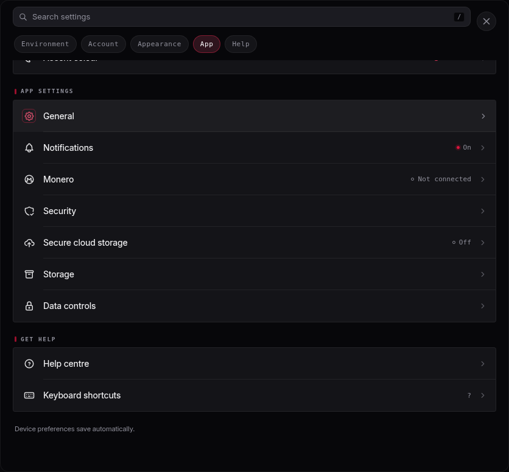

# Settings

Open **Settings** in the top bar, or press **Ctrl/Cmd + ,**. Settings is available while the encrypted workspace is locked. **Escape** returns from a detail view, then closes the dialog. **Ctrl/Cmd + Shift + L** locks an unlocked desktop workspace when no mutation is in progress.

The screen retains the supplied settings structure: a 266px desktop navigation rail, searchable grouped rows, a current-state panel in wide windows, 23px outline-icon tiles and monospaced values. The later [Design Doctrine](DESIGN-DOCTRINE.md) takes precedence: cards and state panels now use flat 4px corners without shadows, brand glow or backdrop blur. Section ticks, active navigation, focus rings and active indicators derive from the selected accent. Compact desktop windows retain search and section chips. Icons and Inter typography are bundled locally. Application-wide visual normalization remains unfinished.

Navigation jumps to sections in one scrollable overview and follows subsequent scrolling. Search filters row names and their current displayed values, hides empty groups and shows “No settings match” when appropriate. Press **/** inside Settings to focus search; typing in a field is left alone. **Escape** clears a nonempty query before returning from a detail or closing the dialog. Search text is not saved.

## Working device preferences

- Appearance: Dark, Light, or System; System follows device colour-scheme changes.
- Accent colour: Crimson (`#dc143c`), Rose, Amber, Teal, Blue or Violet, in that order. Existing Sage/Indigo preferences remain readable and show a saved-colour option until you choose another colour.
- Personalization: Comfortable/Compact profile spacing and Reduce motion.
- Notifications: optional in-app success messages. Errors and important incomplete-snapshot warnings remain visible.

These five enum/boolean preferences save automatically on this device and apply immediately. They persist across app restarts. Only these non-sensitive display/message choices use `ecdys.ui-preferences.v1` in local storage. Invalid data falls back to defaults; failed reads show session-only status immediately at startup, and failed writes keep changes for the current session with the same warning. The footer reflects actual storage availability. No account, email, wallet, credential, navigation history or workspace metadata is stored there.

## Workspace and help

Security can lock the real workspace and explains the existing 15-minute timeout, which measures workspace operations rather than mouse/keyboard activity. Storage shows unlocked workspace profile counts and the selected profile's snapshot count, with complete-backup guidance. Pending or failed reads show **Unknown**, rather than zero. General identifies the app, platform, observed vault state and the boundary between the sandboxed renderer and host operations. A browser-only preview reports the vault as unavailable. Help centre and Keyboard shortcuts explain existing capabilities.

**Data controls → Reset device preferences** restores the five display/message defaults. **Undo reset** restores the previous five values and attempts to persist them through the same storage path. Undo is available while Settings stays open, until another preference change; reset is disabled when values already equal defaults. Workspace, profiles, snapshots and unrelated device storage are preserved.

## Services awaiting integration

Mindmap is unavailable; Email is unlinked; Subscription shows Local preview; Trocador and Monero are not connected; Browsing report and Secure cloud storage are off. SOCKS5 shows **Direct**, meaning no proxy is configured; routing still shows **Blocked** and browser launches remain disabled. Trocador stays under Account, alongside Browsing report. “Weekly” is not shown because there is no report scheduler.

Their detail views explain current limits. Opening Settings makes no integration/network request and does not connect a proxy/wallet. The reference's email, Pro entitlement, unlocked vault and old build number are not copied as application state. The state panel and rail use the actual preference, lock and current version values; filled accent dots indicate active state, and hollow grey dots indicate inactive state.

