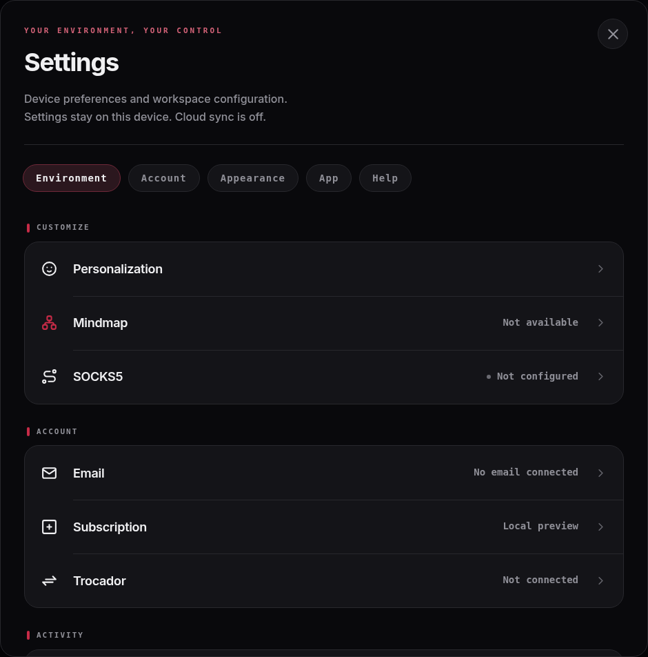
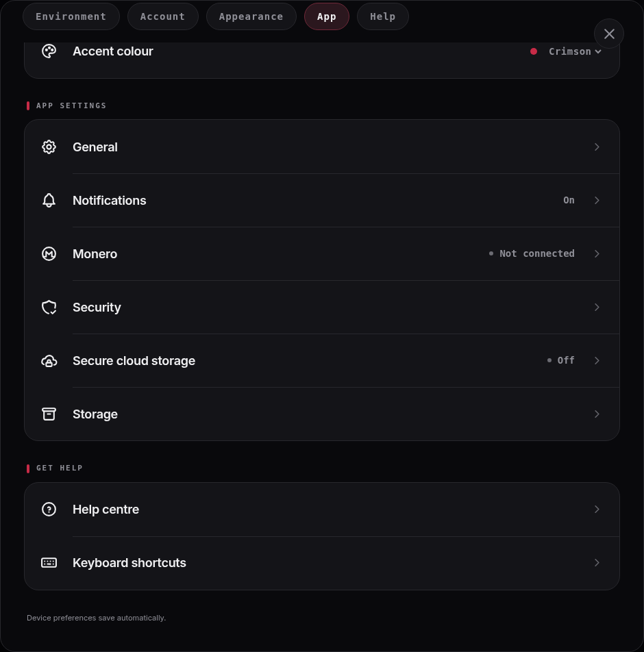
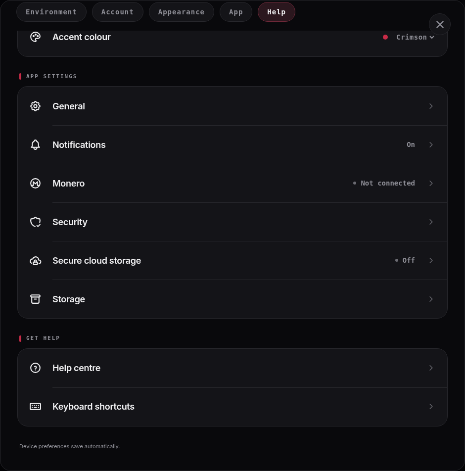

# Settings

Open **Settings** in the top bar, or press **Ctrl/Cmd + ,**. Settings is available while the encrypted workspace is locked. **Escape** returns from a detail view, then closes the dialog. **Ctrl/Cmd + Shift + L** locks an unlocked desktop workspace when no mutation is in progress.

The screen follows the supplied reference: Environment, Account, Appearance, App and Help section navigation; grouped charcoal rows; crimson accents; bundled outline icons and locally bundled Inter typography. Navigation jumps to sections in one scrollable overview. Each row opens a detail view.

## Working device preferences

- Appearance: Dark, Light, or System; System follows device colour-scheme changes.
- Accent colour: Crimson, Sage or Indigo.
- Personalization: Comfortable/Compact profile spacing and Reduce motion.
- Notifications: optional in-app success messages. Errors and important incomplete-snapshot warnings remain visible.

These five enum/boolean preferences save automatically on this device and apply immediately. They persist across app restarts. Only these non-sensitive display/message choices use `ecdys.ui-preferences.v1` in local storage. Invalid data falls back to defaults; failed saves keep the change for the current session and display that storage is unavailable. No account, email, wallet, credential, navigation history or workspace metadata is stored there.

## Workspace and help

Security can lock the real workspace and explains the existing 15-minute timeout, which measures workspace operations rather than mouse/keyboard activity. Storage shows unlocked workspace profile counts and the selected profile's snapshot count, with complete-backup guidance. General identifies the app, platform and lock state. Help centre and Keyboard shortcuts explain existing capabilities.

## Services awaiting integration

Mindmap is unavailable; SOCKS5 is not configured; Email is unlinked; Subscription shows Local preview; Trocador and Monero are not connected; Browsing reports and Secure cloud storage are off. Their detail views explain current limits. Opening Settings makes no integration/network request, does not connect a proxy/wallet, and does not enable profile launches. The reference's example email and Pro entitlement are not used as account data.

